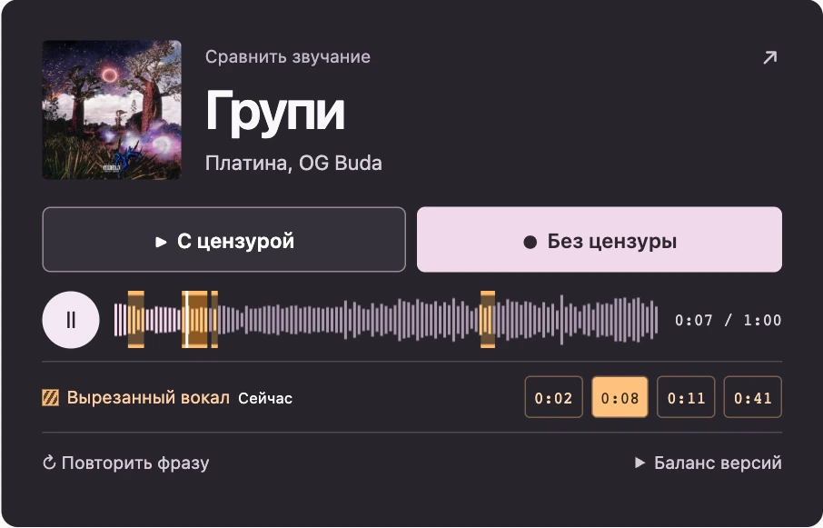

<a href="https://ym.idkroma.ru/">
  <picture>
    <source media="(max-width: 650px)" srcset="docs/readme/cover-mobile.webp">
    
  </picture>
</a>

**[Скачать плеер](https://ym.idkroma.ru/#download)**　·　[Послушать разницу](https://ym.idkroma.ru/#compare)　·　[Поддержать Ex3R](https://pay.cloudtips.ru/p/567e5376)

**YM UNCENSORED** — неофициальный клиент Яндекс Музыки. Включаешь «Мою волну», альбом, плейлист или трек из поиска как обычно. Если для этой записи уже подтверждена версия без цензуры, плеер сверяет оба аудиофайла и может начать сразу с неё даже после переустановки. Для нового трека играет исходник. Если проверка на устройстве находит восстановленные слова, плеер переключается с текущей позиции. При недоступности сервиса исходник продолжает играть. Очередь, обложка и лайки сохраняются.

При первом запуске можно подключить **«Внешние источники»** через отдельный вход в Яндекс ID. Позже этот пункт доступен в настройках. Обычный плеер работает и без подключения. Чтобы найти проверенную пару, сервер получает каталожный ID, название, исполнителей и длительность публичного трека. Музыкальный токен и исходное аудио остаются на устройстве. Личные загрузки в подборе не участвуют.

## Послушать разницу

На сайте есть минута «Групи» Платины и OG Buda. Нажми на метку вырезанной фразы и переключай **«С цензурой» / «Без цензуры»** прямо во время воспроизведения. Обе записи идут синхронно.

## Скачать

**macOS** для Apple Silicon и Intel · **Windows** x64 · **Linux** x86_64 и ARM64 · **Android** 8+ на ARM64. [Все сборки на GitHub](https://github.com/Ex3R/ym-uncensored/releases/latest)

## Исходный код и лицензии

Сайт и загрузки YM UNCENSORED: [ym.idkroma.ru](https://ym.idkroma.ru). Форк сопровождает [Ex3R](https://github.com/Ex3R). [Исходный код](https://github.com/Ex3R/ym-uncensored) · [Обратная связь](https://github.com/Ex3R/ym-uncensored/issues) · [Сообщить об уязвимости](SECURITY.md).

Проект основан на [yamusic-rs](https://github.com/SpolzerMod/yamusic-rs) и его [порте для macOS](https://github.com/M1kage-dev/yamusic-rs). [Лицензия GPL-3.0-only](LICENSE)

Автор исходного yamusic-rs — Spolzer (SpolzerMod); порт для macOS — M1kage-dev. Изменения YM UNCENSORED — Ex3R. Авторство исходного кода и история Git сохранены; старые публичные релизы остаются доступны. Архивный [README исходного проекта](docs/upstream-readme-v1.1.2.md) описывает прежний продукт.

Лицензии встроенных моделей и сторонних компонентов: [models/README.md](models/README.md), [русский словарь](models/RUSSIAN-DICTIONARY-LICENSE), [Whisper](models/WHISPER-LICENSE). Условия сервиса Яндекс Музыки принадлежат Яндексу и не заменяют лицензию кода форка.
