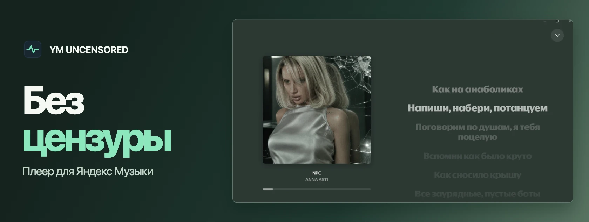

<a href="https://ym.idkroma.ru/">
  <picture>
    <source media="(max-width: 650px)" srcset="docs/readme/cover-mobile.webp">
    
  </picture>
</a>

**[Скачать плеер](https://ym.idkroma.ru/#download)**　·　[Послушать разницу](https://ym.idkroma.ru/#compare)　·　[Поддержать Ex3R](https://pay.cloudtips.ru/p/567e5376)

**YM UNCENSORED** — неофициальный клиент Яндекс Музыки. Включаешь «Мою волну», альбом, плейлист или трек из поиска как обычно. Если в русскоязычном треке вырезаны слова, плеер ищет версию, где их слышно, и автоматически подставляет её в очередь. Если подходящей записи нет, играет исходная.

## Послушать разницу

На сайте есть минута «Групи» Платины и OG Buda. Нажми на метку вырезанной фразы и переключай **«С цензурой» / «Без цензуры»** прямо во время воспроизведения. Обе записи идут синхронно.

## Скачать

**macOS** для Apple Silicon и Intel · **Windows** x64 · **Linux** x86_64 и ARM64 · **Android** 8+ на ARM64. [Все сборки на GitHub](https://github.com/Ex3R/ym-uncensored/releases/latest)

Проект основан на [yamusic-rs](https://github.com/SpolzerMod/yamusic-rs) и его [порте для macOS](https://github.com/M1kage-dev/yamusic-rs). [Лицензия GPL-3.0-only](LICENSE)
